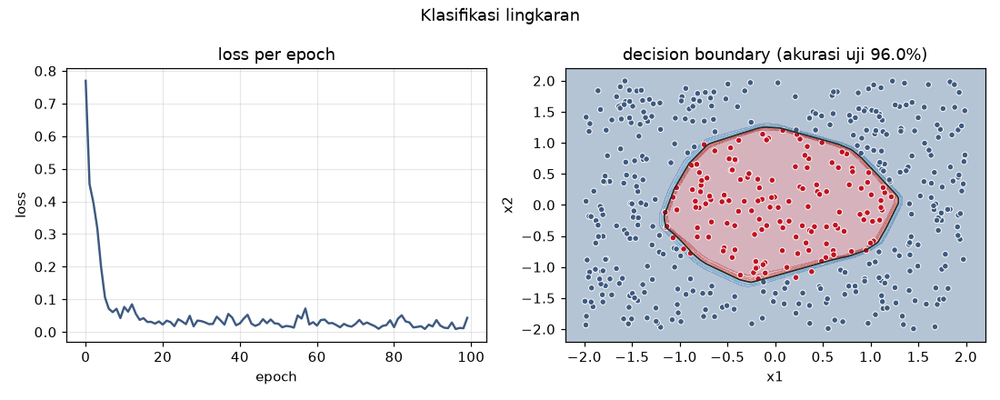
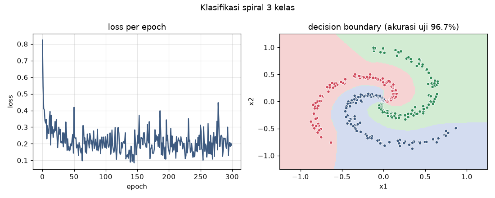
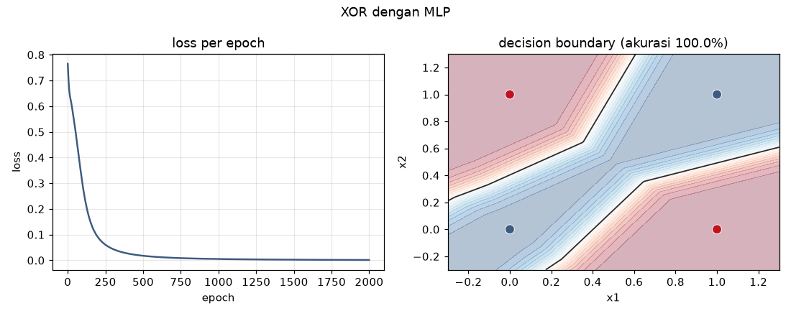

# TinyTorch

Implementasi mini-library deep learning (terinspirasi oleh PyTorch) untuk kebutuhan Jaringan Syaraf Tiruan feedforward. Di dalamnya ada Linear, BatchNorm, ReLU, Sigmoid, Tanh, Softmax, Dropout, Sequential, MSELoss, BCELoss, CrossEntropyLoss, SGD, Adam, dan DataLoader. Forward pass dan backpropagation ditulis manual di atas NumPy tanpa autograd. Bobot disimpan sebagai `Parameter` yang berisi array dan gradien.

`Python 3.12+` · `NumPy` · `backprop manual`

## Fitur

| Kategori     | Komponen                                              |
| ------------ | ----------------------------------------------------- |
| Base         | `Module`, `Parameter`                                 |
| Layer        | `Linear`, `BatchNorm`                                 |
| Aktivasi     | `ReLU`, `Sigmoid`, `Tanh`, `Softmax`                  |
| Regularisasi | `Dropout`                                             |
| Container    | `Sequential`                                          |
| Loss         | `MSELoss`, `BCELoss`, `CrossEntropyLoss`              |
| Optimizer    | `SGD` (momentum, weight decay), `Adam` (weight decay) |
| Data         | `DataLoader` (batch, shuffle, drop_last)              |

## Instalasi

```bash
git clone <url>
cd torch-is-all-u-need
uv sync
```

Jalankan contoh:

```bash
uv run python example/xor.py
uv run python example/spiral.py
uv run python example/circle.py
```

## Quick Start

```python
import numpy as np

from tinytorch import Adam, BCELoss, Linear, ReLU, Sequential, Sigmoid

model = Sequential(Linear(2, 8), ReLU(), Linear(8, 1), Sigmoid())
criterion = BCELoss()
optimizer = Adam(model.parameters(), lr=0.01)

x = np.array([[0.5, -0.2]])   # (batch, fitur)
t = np.array([[1.0]])         # (batch, 1)

pred = model(x)
loss = criterion(pred, t)

optimizer.zero_grad()
model.backward(criterion.backward())
optimizer.step()
```

Input selalu berbentuk `(batch, fitur)`. Untuk klasifikasi multi-kelas, pakai `CrossEntropyLoss` dengan output logits tanpa `Softmax`.

## Hasil







Gambar dibuat ulang dengan:

```bash
uv sync --extra viz
uv run python example/visualize.py
```

## Struktur Project

```
tinytorch/
├── parameter.py   # Parameter: data + grad
├── module.py      # base class Module
├── nn/            # Linear, aktivasi, Dropout, BatchNorm, Sequential
├── loss.py        # MSELoss, BCELoss, CrossEntropyLoss
├── optim.py       # SGD, Adam
└── data.py        # DataLoader
example/
├── xor.py         # XOR dengan MLP
├── spiral.py      # 3 kelas spiral + BatchNorm + Dropout
├── circle.py      # klasifikasi lingkaran 2D
└── visualize.py   # loss + decision boundary untuk README
figures/           # hasil visualize.py
```
